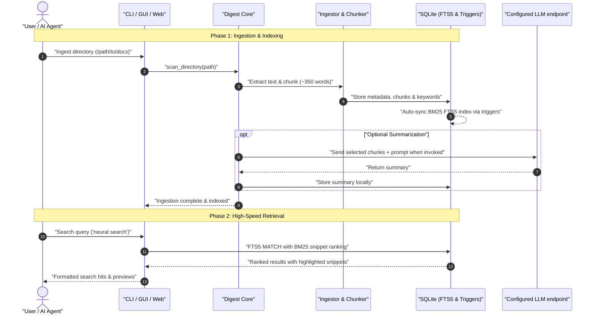

# KnowledgeDigest -- Architecture (v0.4.0)

## Overview

KnowledgeDigest indexes user-selected documents into a local SQLite database and provides FTS5 search through its desktop GUI, web viewer, CLI, and Python API. Optional summarization sends selected chunks and prompts to a configured provider; a custom API endpoint may be remote.

## Module Structure

```
KnowledgeDigest/
├── __init__.py            # Package init, exports KnowledgeDigest class
├── __main__.py            # CLI entrypoint (--gui / --web / CLI commands)
├── config.py              # JSON-based portable config (Config singleton)
├── digest.py              # Main class: high-level API for all operations
├── extractor.py           # Text extraction (PDF, DOCX, HTML, TXT, MD)
├── ingestor.py            # Document ingestion pipeline (detect → extract → chunk → index)
├── chunker.py             # Text chunking (~350 words per chunk, sentence boundaries)
├── indexer.py             # BACH skill indexer (optional, bach.db → knowledge.db)
├── wiki_indexer.py        # BACH wiki indexer (optional, bach.db → knowledge.db)
├── schema.py              # SQLite schema definitions + migrations
├── summarizer.py          # LLM summarization via Anthropic API (optional)
├── utils.py               # Keyword extraction, text utilities
├── web_viewer.py          # Standalone web viewer (Python stdlib only)
├── launcher.py            # PyInstaller EXE launcher
├── gui/
│   ├── __init__.py
│   ├── app.py             # QApplication setup, launch_gui()
│   ├── event_bus.py       # Signal-based event bus for GUI components
│   ├── main_window.py     # Main window with 3-panel splitter layout
│   ├── panels/
│   │   ├── directory_panel.py   # Left panel: indexed directories
│   │   ├── document_list.py     # Center panel: document table
│   │   └── preview_panel.py     # Right panel: document preview
│   ├── widgets/
│   │   └── search_bar.py        # Search input with history
│   └── dialogs/
│       ├── ingest_dialog.py     # Directory ingestion dialog
│       └── settings_dialog.py   # Settings dialog
├── data/
│   ├── .gitkeep
│   ├── knowledge.db       # SQLite database (created at runtime)
│   └── knowledgedigest.json  # Config file (created at runtime)
├── requirements.txt
├── pyproject.toml         # Installable package metadata
├── LICENSE                 # MIT
├── README.md
├── SECURITY.md
├── start.bat              # Windows quick-start script
└── KnowledgeDigest.spec   # PyInstaller build spec
```

## Data Flow

```
Local directories (PDF, DOCX, TXT, MD, HTML)
    │
    v
Ingestor.ingest_directory()
    │
    ├── Extractor: detect file type, extract text
    ├── Chunker: split into ~350-word chunks (sentence boundaries)
    ├── Indexer: insert into SQLite + FTS5
    └── Utils: extract keywords
    │
    v
knowledge.db
    │
    ├── documents          (metadata per file)
    ├── document_chunks    (chunked text, 1:N per document)
    ├── document_fts       (FTS5 index, auto-synced via triggers)
    ├── document_keywords  (extracted keywords, 1:N per document)
    └── summaries          (LLM summaries, optional)
    │
    v
Query via GUI / Web Viewer / CLI / Python API
```

### Sequence Diagram: Ingestion & Retrieval Lifecycle



## Database Schema

Normalized multi-table schema with FTS5 full-text search:

| Table | Purpose |
|-------|---------|
| `documents` | Document metadata (path, filename, type, size, hash) |
| `document_chunks` | Chunked text segments (~350 words each) |
| `document_fts` | FTS5 index over chunks (BM25 ranking, snippets) |
| `document_keywords` | Extracted keywords per document |
| `summaries` | LLM-generated summaries per chunk (optional) |
| `skill_index` | BACH skills metadata (optional) |
| `skill_chunks` | BACH skill chunks (optional) |
| `skill_fts` | FTS5 over skill chunks (optional) |
| `wiki_index` | BACH wiki metadata (optional) |
| `wiki_chunks` | BACH wiki chunks (optional) |
| `wiki_fts` | FTS5 over wiki chunks (optional) |
| `schema_meta` | Schema version for migrations |

## Key Design Decisions

### Portable JSON Config
- No hardcoded paths; everything configurable via `knowledgedigest.json`
- Config search order: CWD → package data/ → %APPDATA% (Windows, when set) → XDG_CONFIG_HOME or ~/.config/knowledgedigest/.
- If no file exists, defaults and package data/ paths are used; an installed package directory may not be writable.
- There is no --config CLI option. Python callers may pass an explicit path to get_config(config_path).

### FTS5 over Keyword Search
- SQLite FTS5 provides BM25 ranking, snippet highlighting, prefix search
- Automatic sync via SQLite triggers
- LIKE-based fallback if FTS5 fails
- Tokenizer: `unicode61` (good for mixed DE/EN content)

### Chunking Strategy
- Target: ~350 words per chunk (~400 tokens)
- Split at paragraph and sentence boundaries (never mid-sentence)
- Small trailing chunks (<50 words) merged with previous
- Optional overlap (default: 0, configurable)

### BACH Integration (Optional)
- Reads `bach.db` in read-only mode (`?mode=ro`)
- Stores indexed data in own `knowledge.db` (never modifies bach.db)
- Lazy-loaded: zero impact when `bach_enabled: false`

### Two Frontends
- **PySide6 GUI**: Full desktop app with 3-panel layout, dark theme
- **Web Viewer**: Python stdlib only; current HTTP server binds to 127.0.0.1 and is not an authenticated remote service

## API

### Python API (digest.py)

| Method | Description |
|--------|-------------|
| `add_directory(path)` | Register directory for indexing |
| `scan_directory(path)` | Ingest all documents from directory |
| `search_all(query)` | FTS5 search across all document chunks |
| `get_document(doc_id)` | Get document with all chunks |
| `get_status()` | Index statistics |
| `list_documents()` | List all indexed documents |

### CLI

```bash
python -m KnowledgeDigest --gui              # Desktop GUI
python -m KnowledgeDigest --web              # Web Viewer
python -m KnowledgeDigest status             # Index statistics
python -m KnowledgeDigest search "query"     # FTS5 search
```

## Provider and Data Boundaries

- Local parsing, indexing, and FTS5 search do not require an LLM provider.
- CLI summarize uses Anthropic by default; --flash selects Google GenAI. The Python API supports Ollama/custom base URLs.
- Provider requests include selected document content and prompts. Custom endpoints may be remote.
- Optional SQLite Transit synchronization can move configured snapshots between nodes.
- The current desktop GUI has German-only visible strings and no language selector.

## Technical Constraints

- Python 3.10+ with sqlite3 FTS5 support
- `PYTHONIOENCODING=utf-8` required on Windows
- Windows-compatible paths and encoding
- PySide6 for GUI, no PyQt dependency; upstream licensing options vary, so inspect the selected distribution's license files
