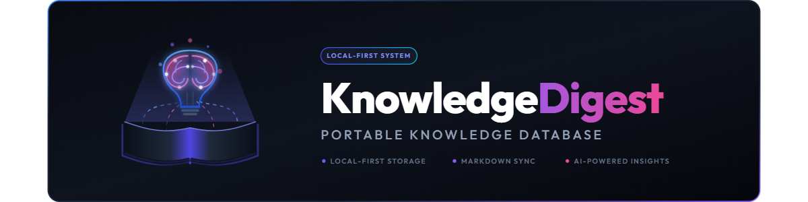
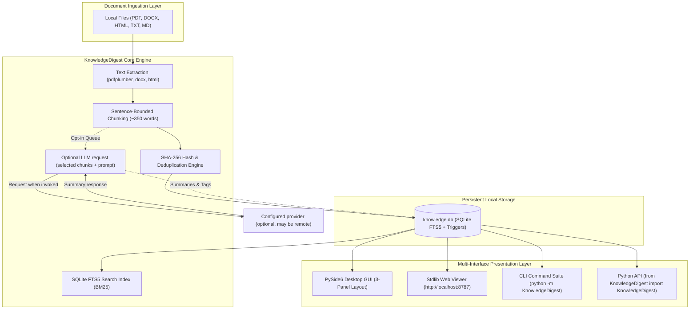
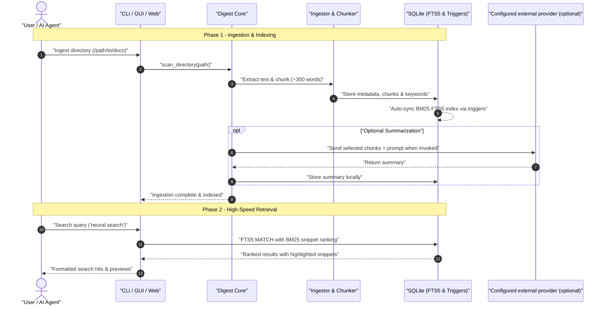

# KnowledgeDigest — Portable Local Knowledge Database

🌐 **English** | [Deutsch](README_de.md)

[](https://www.python.org/)
[](LICENSE)
[](NOTICE)
[](CHANGELOG.md)
[](#3-architecture)
[](#9-desktop-gui)
[](#10-web-viewer)
[](#14-optional-integrations-ecosystem)
[](https://github.com/file-bricks)
[](https://github.com/open-bricks)

> A local-first Python tool for document indexing and SQLite FTS5 search. Optional summarization sends selected text to the configured provider when invoked; provider requests can leave the machine.

> [!NOTE]
> **AI / LLM Integration & Machine-Readable Context**<br>
> Automated AI agents, LLM assistants, and code analysis tools can read [`llms.txt`](llms.txt) for project architecture, safety boundaries, high-intent search terms, and test verification entry points.

---

## 🧭 Quick Navigation

[1. Overview](#1-overview) • [2. Key Features](#2-key-features) • [3. Architecture](#3-architecture) • [4. Lifecycle](#4-lifecycle) • [5. Target Personas](#5-target-personas) • [6. Comparison Matrix](#6-comparison-matrix) • [7. Governance Invariants](#7-governance-invariants) • [8. Search Disambiguation](#8-search-disambiguation) • [9. Desktop GUI](#9-desktop-gui) • [10. Web Viewer](#10-web-viewer) • [11. Multi-Interface CLI](#11-multi-interface-cli) • [12. Python API](#12-python-api) • [13. Configuration & Paths](#13-configuration-paths) • [14. Integrations & Ecosystem](#14-integrations-ecosystem) • [15. Setup & Installation](#15-setup-installation) • [16. Testing & Verification](#16-testing-contract-verification) • [17. Dependency Notes](#17-level-1-sbom-third-party-licenses) • [18. Legal and Support](#18-legal-disclaimer-521-bgb-security-sla)

---

<a id="1-overview"></a><a id="sec-01"></a><a id="overview"></a>
## 1. Overview

**KnowledgeDigest** indexes user-selected documents into a local SQLite database and provides FTS5 full-text search with BM25 ranking. Parsing, chunking, indexing, and ordinary search use the local database and do not require an LLM provider.

Optional summarization is a separate data-flow boundary. When run, selected document chunks and the prompt are sent to the configured provider. The CLI defaults to Anthropic; --flash selects Google GenAI. The Python Summarizer API also supports Ollama or a custom endpoint. A custom endpoint may be remote, so local storage alone does not guarantee that all data stays on the device.

The desktop GUI and web viewer provide alternate interfaces to the configured database.

<a id="2-key-features"></a><a id="sec-02"></a><a id="key-features"></a><a id="features"></a>
## 2. Key Features

- **Local document indexing**: Extracts text and metadata from PDF, DOCX, HTML, Markdown, and text files using optional format-specific packages.
- **SQLite FTS5 search**: Stores indexed content in SQLite and ranks full-text results with BM25.
- **Sentence-bounded chunking**: Splits prose into configurable passages for retrieval and optional summarization.
- **Desktop GUI**: PySide6 interface with directory, document, and preview panels. The current desktop interface is German-only.
- **Local web viewer**: Python standard-library HTTP interface bound to loopback by current source; it is not an authentication or remote-hosting boundary.
- **Optional provider calls**: summarize uses Anthropic by default; summarize --flash uses Google GenAI. The Python API also exposes Ollama/custom endpoint configuration. Provider requests include selected document text and prompts.
- **Optional integrations**: BACH import and SQLite Transit synchronization are separate opt-in paths; they are not required for local indexing or search.
- **MIT-licensed project source**: This describes the project’s own source license, not every transitive dependency or binary distribution.

<a id="3-architecture"></a><a id="sec-03"></a><a id="architecture"></a>
## 3. Architecture & System Topology

The architecture cleanly decouples document ingestion, natural language processing, local relational storage, and presentation:



---

<a id="4-lifecycle"></a><a id="sec-04"></a><a id="lifecycle"></a>
## 4. Ingestion & Retrieval Lifecycle



---

<a id="5-target-personas"></a><a id="sec-05"></a><a id="target-personas"></a>
## 5. Typical Uses

| User | Use |
|---|---|
| Researchers and writers | Search local collections of PDFs, Markdown, DOCX, and text files. |
| Python developers | Embed local indexing and FTS5 retrieval through the Python API. |
| AI developers | Prepare local chunks for an optional, explicitly invoked summarization provider. |
| Small teams | Use a local database and choose whether to configure a separate provider or synchronization feature. |

Optional provider and synchronization workflows are not promised to be offline.

<a id="6-comparison-matrix"></a><a id="sec-06"></a><a id="comparison-matrix"></a>
## 6. Component Boundaries

| Area | KnowledgeDigest behavior |
|---|---|
| Indexing and search | Local SQLite database and FTS5; no provider is required. |
| Summarization | Optional; sends selected chunks and prompts to the configured provider when invoked. |
| Desktop | PySide6 GUI; current visible strings are German-only. |
| Web viewer | Local HTTP interface; current source binds to loopback and applies request checks to state-changing routes. |
| Synchronization | Optional SQLite Transit integration; data movement depends on configured nodes and is separate from the local core path. |
| Licensing | Project source is MIT-licensed. Dependency and distribution licensing requires checking the resolved packages and included license files.

<a id="7-governance-invariants"></a><a id="sec-07"></a><a id="governance-invariants"></a>
## 7. Data-Flow and Runtime Notes

- **Local core path**: File extraction, chunking, SQLite writes, and FTS5 search run against the configured local database.
- **Optional summarization**: The CLI sends selected chunks and a prompt to Anthropic by default or Google GenAI with --flash. The Python API supports Ollama/custom base URLs; these need not be local.
- **Optional synchronization**: SQLite Transit can move configured snapshots between nodes. It is not active in the default local search path.
- **Web viewer**: Current source binds the HTTP server to 127.0.0.1 and checks Host/Origin/Referer for state-changing routes. This is not a substitute for authentication, TLS, or operating-system isolation.
- **User-controlled files**: Users select input directories and database/config paths. Keep the database in a writable location and review selected material before sending it to a provider.
- **Language**: The desktop GUI has no language selector; its visible strings are German. The English and German README share 18 navigation anchor IDs, not full line-by-line translation parity.

<a id="8-search-disambiguation"></a><a id="sec-08"></a><a id="search-disambiguation"></a>
## 8. Scope

KnowledgeDigest indexes local documents and searches them with FTS5. This path does not require a hosted database or LLM provider. Optional summarization and synchronization are separate workflows and may send data to configured external systems. Check the configured provider, endpoint, selected files, and synchronization targets before using them.

Search phrases: portable document search, SQLite FTS5, local document index, Python knowledge database, optional LLM summarization.

<a id="9-desktop-gui"></a><a id="sec-09"></a><a id="desktop-gui"></a>
## 9. Desktop GUI

The PySide6 desktop application has a directory panel, document table, and preview. Its current UI strings are German-only and it has no language selector. The installed package includes the application icon; a package-artifact smoke check verifies that it is loadable.

Launch: `python -m KnowledgeDigest --gui`

The GUI requires the optional gui dependencies and a desktop display.

<a id="10-web-viewer"></a><a id="sec-10"></a><a id="web-viewer"></a>
## 10. Web Viewer

The standard-library HTTP viewer exposes local index summaries, document browsing, and FTS5 search. Current source binds to 127.0.0.1; state-changing routes require POST and validate request headers. It uses local HTTP without TLS and is not an authenticated remote service.

Launch: `python -m KnowledgeDigest --web`

Use --db to provide a database path. Select a writable path and do not expose the viewer through a reverse proxy without a separate security review.

<a id="11-multi-interface-cli"></a><a id="sec-11"></a><a id="multi-interface-cli"></a>
## 11. Multi-Interface Access & CLI

The command line supports local indexing and search. Examples:
- `python -m KnowledgeDigest status`
- `python -m KnowledgeDigest add /path/to/documents`
- `python -m KnowledgeDigest scan`
- `python -m KnowledgeDigest search "machine learning" --limit 10`
- `python -m KnowledgeDigest summarize`
- `python -m KnowledgeDigest summarize --flash`

The default summarization provider is Anthropic. --flash selects Google GenAI. There is no --haiku option. Running summarize contacts the selected provider and can transmit selected document text.

<a id="12-python-api"></a><a id="sec-12"></a><a id="python-api"></a>
## 12. Python API

KnowledgeDigest can be imported directly as an embedded Python library:

```python
from KnowledgeDigest import KnowledgeDigest
from KnowledgeDigest.config import get_config

# Initialize engine with configuration
kd = KnowledgeDigest(config=get_config())

# Register and scan document directory
kd.add_directory("/path/to/docs")
kd.scan_directory("/path/to/docs", recursive=True)

# Perform BM25 full-text search
results = kd.search_all("transformer architecture", limit=5)
for hit in results:
    print(f"[{hit['filename']}] Score: {hit.get('rank', 'N/A')}")
    print(f"Snippet: {hit['snippet']}\n")

# Retrieve system health and index metrics
status = kd.get_status()
print(f"Indexed documents: {status['documents']['total_documents']}")
print(f"Total chunks: {status['documents']['total_chunks']}")
```

---

<a id="13-configuration-paths"></a><a id="sec-13"></a><a id="configuration-paths"></a>
## 13. Configuration & Paths

The program searches for knowledgedigest.json in this order:

1. Current working directory.
2. Package data/ directory.
3. %APPDATA%/KnowledgeDigest/ on Windows, when APPDATA is set.
4. $XDG_CONFIG_HOME/knowledgedigest/, or ~/.config/knowledgedigest/.

If no file exists, built-in defaults use package data/ paths. An installed package directory may not be writable. Set db_path in the config to a user-writable database location.

There is no --config CLI option. Python callers can explicitly choose a config file with get_config(Path(...)), for example get_config(Path("/path/to/knowledgedigest.json")).

Relevant settings include db_path, indexed_directories, chunk_size, web_port, and bach_enabled.

<a id="14-optional-integrations-ecosystem"></a><a id="sec-14"></a><a id="optional-integrations-ecosystem"></a>
## 14. Optional Integrations & Related Tools

- **[BACH](https://github.com/ellmos-ai/bach)**: When enabled, its indexers read the configured BACH SQLite database read-only and copy selected skill/wiki content into the KnowledgeDigest database.
- **[SQLite Transit](https://github.com/ellmos-ai/sqlite-transit-sync)**: An optional adapter can synchronize configured snapshots between systems. It is not part of the default local indexing path.
- **[NoteSpaceLLM](https://github.com/file-bricks/NoteSpaceLLM)**: A related local SQLite/plain-text notebook for notes. It is a separate tool; no runtime integration is claimed.
- **[ProFiler](https://github.com/file-bricks/ProFiler)**: A separate file-management and PDF utility in the file-bricks ecosystem; no built-in integration is claimed.
- **Ecosystem**: KnowledgeDigest is hosted by [file-bricks](https://github.com/file-bricks) and is part of the broader [open-bricks](https://github.com/open-bricks) project family.

<a id="15-setup-installation"></a><a id="sec-15"></a><a id="setup-installation"></a>
## 15. Setup & Installation

### Option A: Editable Local Clone (Recommended)
```bash
git clone https://github.com/file-bricks/knowledgedigest.git
cd knowledgedigest
python -m pip install --upgrade pip
python -m pip install -e ".[all]"
```

### Option B: Direct Git Install
```bash
pip install "knowledgedigest[gui] @ git+https://github.com/file-bricks/knowledgedigest.git"
```

---

<a id="16-testing-contract-verification"></a><a id="sec-16"></a><a id="testing-contract-verification"></a>
## 16. Testing & Verification

Run the test suite with python -m pytest tests. Optional SQLite Transit tests are skipped when that separately installed dependency is unavailable. The main suite covers indexing/search, web-viewer request checks, metadata contracts, and selected integrations.

The CI packaging job builds a wheel and source distribution, installs both into separate targets, and checks the packaged icon and CLI help. A passing test run is evidence for those tested paths, not a complete security, license, or dependency audit.

<a id="17-level-1-sbom-third-party-licenses"></a><a id="sec-17"></a><a id="level-1-sbom-third-party-licenses"></a>
## 17. Direct Dependency Notes

[THIRD_PARTY_LICENSES.md](THIRD_PARTY_LICENSES.md) records a bounded snapshot of declared direct dependencies and license references. It is manually maintained, is not a generated SBOM, and does not enumerate every transitive dependency or installer-specific binary. Check the actual distributions and their included license files before redistributing an environment.

The project source is MIT-licensed; this does not relicense dependencies.

<a id="18-legal-disclaimer-521-bgb-security-sla"></a><a id="sec-18"></a><a id="legal-disclaimer-521-bgb-security-sla"></a>
## 18. Legal and Support Information

KnowledgeDigest is software, not legal, tax, financial, privacy, or compliance advice. The MIT license is the project’s license; this documentation makes no legal conclusion about liability or the legal role of a particular deployment.

Security response times are maintainer goals, not a guaranteed service level. Check the repository’s Security tab to see whether GitHub Private Vulnerability Reporting is enabled. If it is unavailable, do not publish vulnerability details in a public issue; ask the maintainers for a private contact route.

Copyright (c) 2026 Lukas Geiger. See [LICENSE](LICENSE) and [NOTICE](NOTICE).
