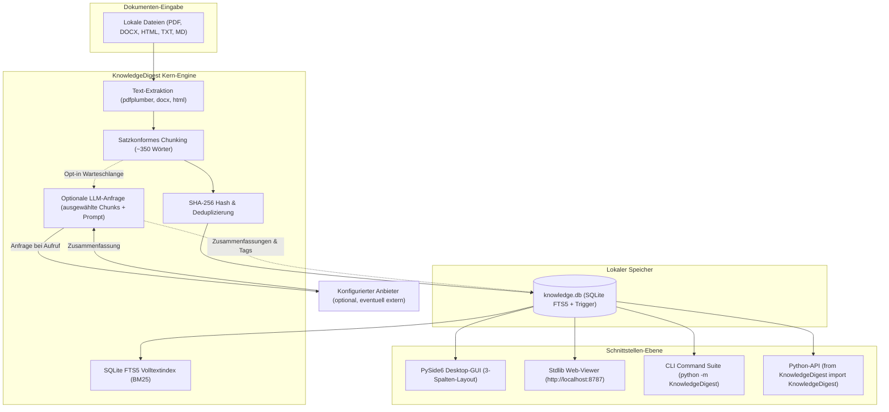
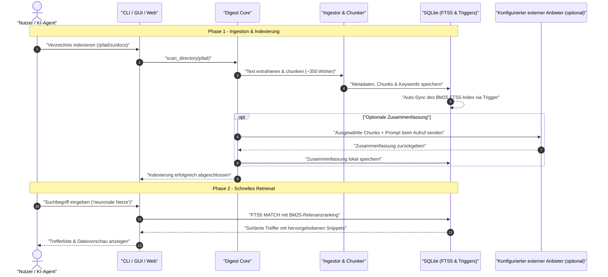

# KnowledgeDigest — Portable Lokale Wissensdatenbank

[English](README.md) | 🌐 **Deutsch**

[](https://www.python.org/)
[](LICENSE)
[](NOTICE)
[](CHANGELOG.md)
[](#3-architecture)
[](#9-desktop-gui)
[](#10-web-viewer)
[](#14-optional-integrations-ecosystem)
[](https://github.com/file-bricks)
[](https://github.com/open-bricks)

> Ein lokales Python-Werkzeug zur Dokumentenindexierung und SQLite-FTS5-Suche. Bei einer ausdrücklich gestarteten optionalen Zusammenfassung werden ausgewählte Texte an den konfigurierten Anbieter gesendet; solche Anbieteranfragen können das Gerät verlassen.

> [!NOTE]
> **KI- / LLM-Integration & Maschinenlesbarer Kontext**<br>
> Automatisierte KI-Agenten, LLM-Assistenten und Code-Analyse-Werkzeuge können [`llms.txt`](llms.txt) für Projektarchitektur, Sicherheitsgrenzen, Suchbegriffe und Verifikationseinstiege heranziehen.

---

## 🧭 Schnellnavigation

[1. Übersicht](#1-overview) • [2. Kernfunktionen](#2-key-features) • [3. Architektur](#3-architecture) • [4. Lebenszyklus](#4-lifecycle) • [5. Ziel-Personas](#5-target-personas) • [6. Vergleichsmatrix](#6-comparison-matrix) • [7. Governance-Invarianten](#7-governance-invariants) • [8. Begriffsklärung](#8-search-disambiguation) • [9. Desktop-GUI](#9-desktop-gui) • [10. Web-Viewer](#10-web-viewer) • [11. CLI-Werkzeuge](#11-multi-interface-cli) • [12. Python-API](#12-python-api) • [13. Konfiguration & Pfade](#13-configuration-paths) • [14. Ökosystem & Verwandtes](#14-integrations-ecosystem) • [15. Installation](#15-setup-installation) • [16. Tests & Vertragssicherheit](#16-testing-contract-verification) • [17. Abhängigkeitshinweise](#17-level-1-sbom-third-party-licenses) • [18. Rechtliche Hinweise](#18-legal-disclaimer-521-bgb-security-sla)

---

<a id="1-overview"></a><a id="sec-01"></a><a id="overview"></a>
## 1. Übersicht

**KnowledgeDigest** indexiert vom Nutzer ausgewählte Dokumente in einer lokalen SQLite-Datenbank und bietet FTS5-Volltextsuche mit BM25-Ranking. Textextraktion, Chunking, Indexierung und normale Suchanfragen nutzen die lokale Datenbank und benötigen keinen LLM-Anbieter.

Optionale Zusammenfassungen bilden eine eigene Datenflussgrenze. Beim ausdrücklichen Start werden ausgewählte Dokumentabschnitte und der Prompt an den konfigurierten Anbieter gesendet. Die CLI verwendet standardmäßig Anthropic; --flash wählt Google GenAI. Die Python-API Summarizer unterstützt außerdem Ollama oder einen benutzerdefinierten Endpunkt. Ein solcher Endpunkt kann extern liegen. Lokale Speicherung allein garantiert daher nicht, dass alle Daten auf dem Gerät bleiben.

Desktop-GUI und Web-Viewer sind alternative Oberflächen für dieselbe konfigurierte Datenbank.

<a id="2-key-features"></a><a id="sec-02"></a><a id="key-features"></a><a id="features"></a>
## 2. Kernfunktionen

- **Lokale Dokumentenindexierung**: Extrahiert Text und Metadaten aus PDF, DOCX, HTML, Markdown und Textdateien; dafür werden optionale Formatpakete verwendet.
- **SQLite-FTS5-Suche**: Speichert indexierte Inhalte in SQLite und ordnet Volltexttreffer mit BM25.
- **Satzbezogenes Chunking**: Teilt Fließtext in einstellbare Abschnitte für Suche und optionale Zusammenfassungen.
- **Desktop-GUI**: PySide6-Oberfläche mit Verzeichnis-, Dokumenten- und Vorschau-Spalte. Die aktuelle Desktop-Oberfläche ist nur auf Deutsch verfügbar.
- **Lokaler Web-Viewer**: HTTP-Oberfläche aus der Python-Standardbibliothek, die laut aktueller Implementierung an Loopback gebunden ist; sie ist keine Authentifizierungs- oder Remote-Hosting-Grenze.
- **Optionale Anbieteranfragen**: summarize nutzt standardmäßig Anthropic; summarize --flash nutzt Google GenAI. Die Python-API bietet außerdem Ollama und benutzerdefinierte Endpunkte. Anbieteranfragen enthalten ausgewählte Dokumenttexte und Prompts.
- **Optionale Integrationen**: BACH-Import und SQLite-Transit-Synchronisierung sind getrennte, optionale Pfade. Sie werden für lokale Indexierung und Suche nicht benötigt.
- **MIT-Lizenz für den Projektquelltext**: Das beschreibt die Lizenz des eigenen Quelltexts, nicht sämtliche indirekten Abhängigkeiten oder Binärpakete.

<a id="3-architecture"></a><a id="sec-03"></a><a id="architecture"></a>
## 3. Architektur & Systemtopologie

Die Architektur trennt Datenaufnahme, Textverarbeitung, lokale Speicherung und Präsentation in klar entkoppelte Schichten:



---

<a id="4-lifecycle"></a><a id="sec-04"></a><a id="lifecycle"></a>
## 4. Ingestion & Retrieval Lebenszyklus



---

<a id="5-target-personas"></a><a id="sec-05"></a><a id="target-personas"></a>
## 5. Typische Anwendungsfälle

| Nutzergruppe | Einsatz |
|---|---|
| Forschende und Schreibende | Lokale Sammlungen aus PDF-, Markdown-, DOCX- und Textdateien durchsuchen. |
| Python-Entwickler | Lokale Indexierung und FTS5-Abfragen über die Python-API einbinden. |
| KI-Entwickler | Lokale Textabschnitte für eine optionale, ausdrücklich gestartete Zusammenfassung vorbereiten. |
| Kleine Teams | Eine lokale Datenbank nutzen und einen separaten Anbieter oder eine Synchronisierungsfunktion bewusst konfigurieren. |

Für optionale Anbieter- oder Synchronisierungsabläufe wird kein Offline-Betrieb zugesagt.

<a id="6-comparison-matrix"></a><a id="sec-06"></a><a id="comparison-matrix"></a>
## 6. Komponenten und Grenzen

| Bereich | Verhalten von KnowledgeDigest |
|---|---|
| Indexierung und Suche | Lokale SQLite-Datenbank und FTS5; kein Anbieter erforderlich. |
| Zusammenfassungen | Optional; beim Aufruf werden ausgewählte Textabschnitte und Prompts an den konfigurierten Anbieter gesendet. |
| Desktop | PySide6-GUI; die aktuellen sichtbaren Texte sind nur auf Deutsch verfügbar. |
| Web-Viewer | Lokale HTTP-Oberfläche; der aktuelle Quelltext bindet an Loopback und prüft schreibende Anfragen. |
| Synchronisierung | Optionale SQLite-Transit-Integration; Datenbewegung hängt von den konfigurierten Knoten ab und ist vom lokalen Kernpfad getrennt. |
| Lizenzierung | Der Projektquelltext steht unter MIT. Abhängigkeiten und Distributionen müssen anhand der tatsächlich aufgelösten Pakete und enthaltenen Lizenzdateien geprüft werden.

<a id="7-governance-invariants"></a><a id="sec-07"></a><a id="governance-invariants"></a>
## 7. Datenfluss und Laufzeit

- **Lokaler Kernpfad**: Textextraktion, Chunking, SQLite-Schreibvorgänge und FTS5-Suche verwenden die konfigurierte lokale Datenbank.
- **Optionale Zusammenfassungen**: Die CLI sendet ausgewählte Textabschnitte und einen Prompt standardmäßig an Anthropic oder mit --flash an Google GenAI. Die Python-API unterstützt Ollama und benutzerdefinierte Basis-URLs; diese müssen nicht lokal sein.
- **Optionale Synchronisierung**: SQLite Transit kann konfigurierte Snapshots zwischen Knoten übertragen. Im standardmäßigen lokalen Suchpfad ist diese Funktion nicht aktiv.
- **Web-Viewer**: Der aktuelle Quelltext bindet den HTTP-Server an 127.0.0.1 und prüft Host/Origin/Referer für schreibende Routen. Das ersetzt weder Authentifizierung noch TLS oder Betriebssystem-Isolation.
- **Dateien unter Nutzerkontrolle**: Nutzer wählen Eingabeverzeichnisse und Datenbank-/Konfigurationspfade. Die Datenbank muss an einem beschreibbaren Ort liegen; vor einer Anbieteranfrage sollten die ausgewählten Inhalte geprüft werden.
- **Sprache**: Die Desktop-GUI hat keinen Sprachumschalter; ihre Oberflächentexte sind deutsch. Die englische und deutsche README teilen 18 Anker-IDs, keine vollständige zeilenweise Übersetzungsparität.

<a id="8-search-disambiguation"></a><a id="sec-08"></a><a id="search-disambiguation"></a>
## 8. Umfang

KnowledgeDigest indexiert lokale Dokumente und durchsucht sie mit FTS5. Dieser Pfad benötigt weder eine gehostete Datenbank noch einen LLM-Anbieter. Optionale Zusammenfassungen und Synchronisierung sind getrennte Abläufe und können Daten an konfigurierte externe Systeme senden. Prüfen Sie vor deren Nutzung Anbieter, Endpunkt, ausgewählte Dateien und Synchronisierungsziele.

Suchbegriffe: lokale Dokumentensuche, SQLite FTS5, Python-Wissensdatenbank, Dokumentenindex, optionale LLM-Zusammenfassung.

<a id="9-desktop-gui"></a><a id="sec-09"></a><a id="desktop-gui"></a>
## 9. Desktop-GUI

Die PySide6-Desktopanwendung hat eine Verzeichnisleiste, eine Dokumententabelle und eine Vorschau. Ihre aktuellen Oberflächentexte sind deutsch; einen Sprachumschalter gibt es nicht. Das installierte Paket enthält das Anwendungssymbol; ein Paket-Smoke-Check prüft, ob es geladen werden kann.

Start: `python -m KnowledgeDigest --gui`

Die GUI benötigt die optionale Gruppe gui und eine grafische Anzeige.

<a id="10-web-viewer"></a><a id="sec-10"></a><a id="web-viewer"></a>
## 10. Web-Viewer

Der HTTP-Viewer aus der Standardbibliothek zeigt lokale Indexdaten, Dokumente und FTS5-Suchergebnisse. Der aktuelle Quelltext bindet an 127.0.0.1; schreibende Routen verlangen POST und prüfen Request-Header. Er verwendet lokales HTTP ohne TLS und ist kein authentifizierter Remote-Dienst.

Start: `python -m KnowledgeDigest --web`

Mit --db lässt sich ein Datenbankpfad angeben. Verwenden Sie einen beschreibbaren Speicherort und stellen Sie den Viewer nicht ohne zusätzliche Sicherheitsprüfung über einen Reverse-Proxy bereit.

<a id="11-multi-interface-cli"></a><a id="sec-11"></a><a id="multi-interface-cli"></a>
## 11. CLI und Oberflächen

Die CLI unterstützt lokale Indexierung und Suche, zum Beispiel:
- `python -m KnowledgeDigest status`
- `python -m KnowledgeDigest add /pfad/zu/dokumenten`
- `python -m KnowledgeDigest scan`
- `python -m KnowledgeDigest search "maschinelles Lernen" --limit 10`
- `python -m KnowledgeDigest summarize`
- `python -m KnowledgeDigest summarize --flash`

Der Standardanbieter für Zusammenfassungen ist Anthropic. --flash wählt Google GenAI. Eine Option --haiku gibt es nicht. summarize kontaktiert den ausgewählten Anbieter und kann ausgewählte Dokumenttexte übertragen.

<a id="12-python-api"></a><a id="sec-12"></a><a id="python-api"></a>
## 12. Python-API

KnowledgeDigest kann als Bibliothek direkt in Python-Projekte eingebunden werden:

```python
from KnowledgeDigest import KnowledgeDigest
from KnowledgeDigest.config import get_config

# Initialisierung mit Konfiguration
kd = KnowledgeDigest(config=get_config())

# Verzeichnis hinzufügen und einlesen
kd.add_directory("/pfad/zu/docs")
kd.scan_directory("/pfad/zu/docs", recursive=True)

# Volltextsuche via FTS5 und BM25
results = kd.search_all("transformer architektur", limit=5)
for hit in results:
    print(f"[{hit['filename']}] Relevanz: {hit.get('rank', 'N/A')}")
    print(f"Auszug: {hit['snippet']}\n")

# Systemstatus abfragen
status = kd.get_status()
print(f"Dokumente: {status['documents']['total_documents']}")
print(f"Chunks: {status['documents']['total_chunks']}")
```

---

<a id="13-configuration-paths"></a><a id="sec-13"></a><a id="configuration-paths"></a>
## 13. Konfiguration und Pfade

Das Programm sucht knowledgedigest.json in dieser Reihenfolge:

1. Aktuelles Arbeitsverzeichnis.
2. Paketverzeichnis data/.
3. Unter Windows APPDATA/KnowledgeDigest/, sofern APPDATA gesetzt ist.
4. XDG_CONFIG_HOME/knowledgedigest/ oder ~/.config/knowledgedigest/.

Existiert keine Datei, verwendet das Programm eingebaute Standardwerte und Paketpfade unter data/. Ein installiertes Paketverzeichnis muss nicht beschreibbar sein. Setzen Sie db_path in der Konfiguration auf einen für Sie beschreibbaren Datenbankpfad.

Eine CLI-Option --config gibt es nicht. Python-Aufrufer können eine Konfigurationsdatei ausdrücklich über get_config(Path(...)) auswählen, zum Beispiel get_config(Path("/pfad/zu/knowledgedigest.json")).

Wichtige Einstellungen sind db_path, indexed_directories, chunk_size, web_port und bach_enabled.

<a id="14-optional-integrations-ecosystem"></a><a id="sec-14"></a><a id="optional-integrations-ecosystem"></a>
## 14. Optionale Integrationen und verwandte Werkzeuge

- **[BACH](https://github.com/ellmos-ai/bach)**: Wenn aktiviert, lesen die BACH-Indexer die konfigurierte BACH-SQLite-Datenbank schreibgeschützt und übernehmen ausgewählte Skill-/Wiki-Inhalte in die KnowledgeDigest-Datenbank.
- **[SQLite Transit](https://github.com/ellmos-ai/sqlite-transit-sync)**: Ein optionaler Adapter kann konfigurierte Snapshots zwischen Systemen synchronisieren. Er gehört nicht zum standardmäßigen lokalen Indexierungspfad.
- **[NoteSpaceLLM](https://github.com/file-bricks/NoteSpaceLLM)**: Ein verwandtes lokales SQLite-/Textnotizbuch. Es ist ein eigenes Werkzeug; eine Laufzeitintegration wird nicht behauptet.
- **[ProFiler](https://github.com/file-bricks/ProFiler)**: Ein separates Datei- und PDF-Werkzeug im file-bricks-Ökosystem; eine integrierte Verbindung wird nicht behauptet.
- **Ökosystem**: KnowledgeDigest wird von [file-bricks](https://github.com/file-bricks) gehostet und gehört zur Projektfamilie [open-bricks](https://github.com/open-bricks).

<a id="15-setup-installation"></a><a id="sec-15"></a><a id="setup-installation"></a>
## 15. Setup & Installation

### Option A: Editierbarer lokaler Klon (Empfohlen)
```bash
git clone https://github.com/file-bricks/knowledgedigest.git
cd knowledgedigest
python -m pip install --upgrade pip
python -m pip install -e ".[all]"
```

### Option B: Direkte Installation via Git
```bash
pip install "knowledgedigest[gui] @ git+https://github.com/file-bricks/knowledgedigest.git"
```

---

<a id="16-testing-contract-verification"></a><a id="sec-16"></a><a id="testing-contract-verification"></a>
## 16. Tests und Verifikation

Führen Sie die Tests mit python -m pytest tests aus. Optionale SQLite-Transit-Tests werden übersprungen, wenn die separat installierte Abhängigkeit fehlt. Die Hauptsuite prüft Indexierung und Suche, Request-Prüfungen des Web-Viewers, Metadatenverträge und ausgewählte Integrationen.

Der CI-Paketjob baut außerdem ein Wheel und eine Source-Distribution, installiert beide in getrennte Zielverzeichnisse und prüft das enthaltene Symbol sowie die CLI-Hilfe. Ein erfolgreicher Testlauf belegt nur die geprüften Pfade, keine vollständige Sicherheits-, Lizenz- oder Abhängigkeitsprüfung.

<a id="17-level-1-sbom-third-party-licenses"></a><a id="sec-17"></a><a id="level-1-sbom-third-party-licenses"></a>
## 17. Hinweise zu direkten Abhängigkeiten

[THIRD_PARTY_LICENSES.md](THIRD_PARTY_LICENSES.md) enthält eine begrenzte, manuell gepflegte Momentaufnahme deklarierter direkter Abhängigkeiten und Lizenzverweise. Sie ist keine generierte SBOM und listet nicht jede indirekte Abhängigkeit oder jede distributionsspezifische Binärdatei auf. Prüfen Sie vor einer Weitergabe die tatsächlich installierten Pakete und deren Lizenzdateien.

Der Projektquelltext steht unter MIT. Das ändert nicht die Lizenzen seiner Abhängigkeiten.

<a id="18-legal-disclaimer-521-bgb-security-sla"></a><a id="sec-18"></a><a id="legal-disclaimer-521-bgb-security-sla"></a>
## 18. Rechtliche Hinweise und Support

KnowledgeDigest ist Software und keine Rechts-, Steuer-, Finanz-, Datenschutz- oder Compliance-Beratung. Die MIT-Lizenz ist die Projektlizenz; diese Dokumentation trifft keine rechtliche Aussage zur Haftung oder zur rechtlichen Rolle einer konkreten Nutzung.

Reaktionszeiten bei Sicherheitsmeldungen sind Ziele der Maintainer, keine garantierte Serviceleistung. Prüfen Sie im Security-Tab des Repositories, ob GitHub Private Vulnerability Reporting aktuell aktiviert ist. Falls es nicht verfügbar ist, veröffentlichen Sie keine Schwachstellendetails in einem öffentlichen Issue, sondern bitten Sie die Maintainer um einen privaten Kontaktweg.

Copyright (c) 2026 Lukas Geiger. Siehe [LICENSE](LICENSE) und [NOTICE](NOTICE).
